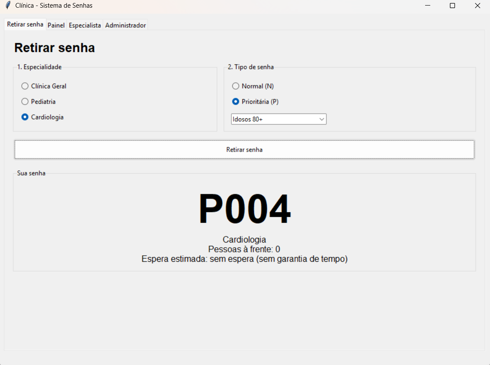
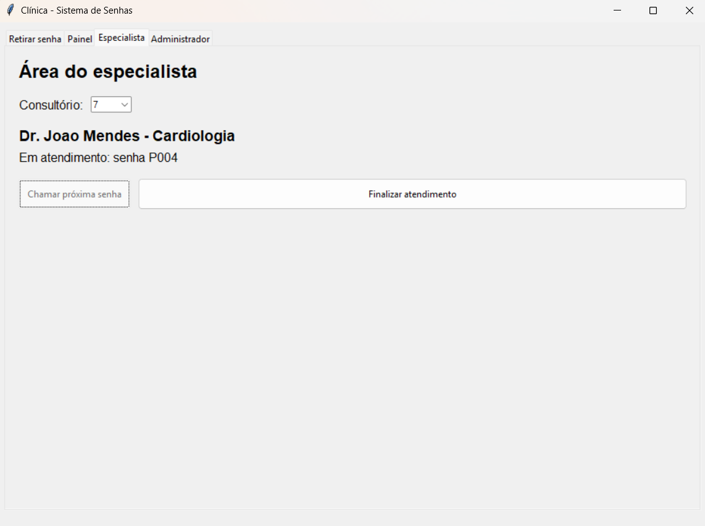
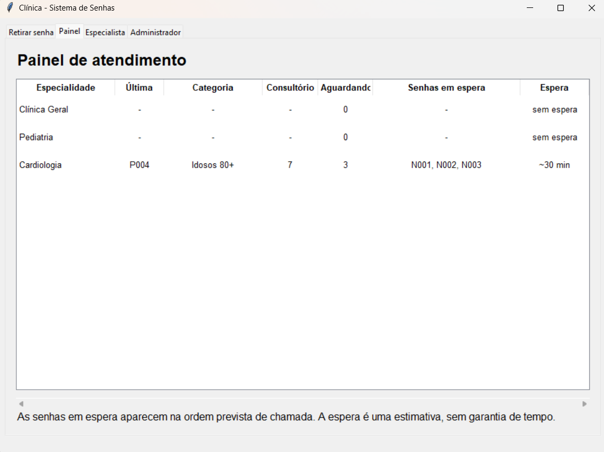

# Sistema de Senhas para Clínica Médica

Este projeto implementa, em Python, um sistema de atendimento para uma clínica médica. O paciente escolhe uma especialidade e recebe uma senha normal ou prioritária. O especialista chama a próxima senha, e o painel informa a chamada atual e a situação da fila.

O sistema pode ser usado por uma janela gráfica ou pelo terminal. Também mantém os dados em SQLite, restaura as filas ao reabrir durante o dia e gera relatórios diários. As funcionalidades têm testes automatizados no pacote `testes/`.

## Objetivos

- Emitir senhas normais e prioritárias para cada especialidade.
- Organizar as senhas prioritárias por prioridade e ordem de chegada, mantendo as normais em ordem FIFO.
- Permitir que especialistas chamem pacientes para seus consultórios.
- Exibir informações da chamada e uma estimativa de espera.
- Registrar os atendimentos do dia em SQLite e gerar um relatório diário.

## Especialidades e prioridades

O sistema oferece três especialidades: Clínica Geral, Pediatria e Cardiologia, com até três especialistas por especialidade. A Ginecologia foi retirada das opções para novos atendimentos, conforme o limite do trabalho. O enum legado é mantido internamente para permitir a leitura de registros antigos do SQLite. Há 12 consultórios disponíveis.

| Código | Prioridade |
| --- | --- |
| 1 | Idosos com 80 anos ou mais |
| 2 | Idosos de 60 a 79 anos |
| 3 | Pessoas com deficiência (PCD) |
| 4 | Gestantes |
| 5 | Pessoas obesas |
| 6 | Crianças no colo |
| 7 | Senha normal |

Os códigos de 1 a 6 representam as categorias prioritárias. O código 2, para idosos de 60 a 79 anos, e a ordem de atendimento entre categorias foram definidos pelo grupo. O código 7 representa a senha normal. As senhas normais não entram no heap: ficam em uma fila FIFO (`deque`) e só são chamadas quando não há senha prioritária aguardando.

## Tecnologias

- Python 3.10 ou superior.
- `dataclasses` e `Enum` para os modelos.
- `heapq` para as filas de prioridade.
- `collections.deque` para manter as senhas normais em ordem FIFO.
- `sqlite3` para persistir os dados do dia.
- `csv`, `zipfile` e `xml.etree` para gerar os relatórios em CSV e Excel (`.xlsx`), sem bibliotecas externas.
- Tkinter para a interface gráfica.

Todas as bibliotecas citadas fazem parte da biblioteca padrão do Python; o projeto não tem dependências externas.

## Estruturas de dados

- **Heap (`heapq`) para senhas prioritárias:** cada elemento é ordenado pelo código da prioridade (menor código primeiro) e, em caso de empate, pelo número da senha. Assim, a fila respeita a prioridade definida pelo grupo e mantém FIFO entre pessoas da mesma categoria.
- **Fila FIFO (`deque`) para senhas normais:** novas senhas entram no fim e a próxima chamada sai do começo. Senhas normais só são chamadas quando não há prioridade aguardando.
- **Uma fila por especialidade (`dict`):** o gerenciador localiza rapidamente a fila correspondente e não mistura pacientes de especialidades diferentes.
- **Dicionário de atendimentos por consultório:** associa cada consultório à senha que está em atendimento, impedindo uma segunda chamada enquanto o atendimento anterior não for finalizado.
- **SQLite para persistência:** as senhas, especialistas e dados de autenticação ficam armazenados para que o sistema possa ser reaberto durante o dia.

### Numeração das senhas

Cada especialidade tem um contador compartilhado pelas categorias normal e prioritária. A letra identifica a categoria (`N` para normal e `P` para prioritária), e os três dígitos indicam a sequência de emissão naquela especialidade. Assim, uma senha normal `N001` seguida por uma prioritária pode resultar em `P002`. O contador não reinicia para cada categoria.

### Ordem de chamada adotada

As senhas prioritárias são chamadas pela ordem dos códigos de prioridade de 1 a 6 e, dentro da mesma categoria, por ordem de chegada. Senhas normais mantêm FIFO e aguardam enquanto houver alguma prioridade na fila. Essa é a política de atendimento implementada pelo grupo.

## Organização dos módulos

O código fica no pacote `clinica/`, com uma pasta por módulo do enunciado. Cada pasta tem um `__init__.py` que indica o que os outros módulos podem usar, então quem importa não precisa saber em qual arquivo cada classe está. O `main.py` fica na raiz.

```
Clinica-SistemaSenhaPrioridade/
├── main.py
├── clinica/
│   ├── sistema.py        integra cadastro, filas, painel, banco e relatório
│   ├── modelos/          enums.py, entidades.py
│   ├── especialistas/    cadastro.py, administrador.py
│   ├── filas/            fila_especialidade.py, gerenciador.py
│   ├── painel/           painel.py
│   ├── relatorio/        repositorio.py, relatorio.py
│   └── interface/        janela.py (Tkinter), terminal.py
└── testes/
```

| Pasta | Responsabilidade | Estado |
| --- | --- | --- |
| `clinica/modelos/` | Especialidades, prioridades, estados, senhas e especialistas (o `Especialista` é imutável: depois de cadastrado, não pode ser alterado por fora) | Implementado |
| `clinica/especialistas/` | Cadastro de especialistas e autenticação do administrador | Implementado |
| `clinica/filas/` | Emissão e chamada de senhas, fila FIFO para senhas normais, heap para prioritárias, encerramento diário e estimativas de espera | Implementado |
| `clinica/painel/` | Última senha chamada, categoria, consultório, quantidade e relação de senhas aguardando, além da espera estimada, em dados puros (`LinhaPainel`) e em texto para o terminal | Implementado |
| `clinica/relatorio/` | Gravação das senhas, do cadastro e do administrador no SQLite (`Repositorio`) e relatório diário em texto (`Relatorio`), salvo em `relatorios/relatorio_AAAA-MM-DD.txt`; o mesmo módulo também gera as senhas do dia em CSV (`salvar_csv`) e em Excel (`salvar_excel`) | Implementado |
| `clinica/sistema.py` | Porta de entrada única: abre o dia, restaura as filas do banco, controla o acesso do administrador, grava no SQLite, gera o relatório e exporta em CSV e Excel | Implementado |
| `clinica/interface/` | Janela em Tkinter com quatro abas (`janela.py`) e menu de terminal (`terminal.py`, com consulta de relatórios por data); as duas só desenham e chamam o `Sistema` | Implementado |
| `main.py` | Ponto de entrada: cria o `Sistema` e abre a janela (ou o terminal, com `--terminal`) | Implementado |

Os módulos são importados a partir da raiz do projeto, por exemplo `from clinica.filas import GerenciadorFilas`. Os comandos devem ser executados na pasta raiz.

## Regras do projeto

- Cada especialidade pode ter até três especialistas; os consultórios vão de 1 a 12.
- Uma especialidade sem especialista cadastrado não deve emitir senhas.
- O tempo médio de atendimento usado na estimativa é de 30 minutos.
- A senha é diária: senhas não atendidas até o encerramento não passam para o dia seguinte.
- A clínica não realiza atendimentos de emergência.
- A prioridade estrita foi definida pelo grupo: senhas prioritárias são chamadas antes das normais; entre prioritárias, vale o menor código e, no empate, a ordem de chegada.
- A estimativa geral de espera considera o total de senhas aguardando, o tempo médio de atendimento de 30 minutos e a quantidade de consultórios ativos da especialidade.
- A estimativa por senha usa a mesma conta da estimativa geral: quantidade de pessoas à frente multiplicada por 30 minutos e dividida pelos consultórios ativos da especialidade, arredondada para cima. Por ser uma média, deve ser exibida como estimativa, sem garantia de tempo.
- No encerramento diário, senhas ainda aguardando ficam como não atendidas; atendimentos que já começaram contam como finalizados, sem horário final inventado.

## Aderência à especificação

- **Quantidade de integrantes:** equipe com cinco pessoas, composição aprovada pela professora.
- **Especialidades:** Clínica Geral, Pediatria e Cardiologia. Registros legados de Ginecologia podem continuar existindo em bancos anteriores, mas a especialidade não aparece nos menus para novos atendimentos.
- **Numeração:** o sistema usa um contador compartilhado por categoria dentro de cada especialidade (`N001`, depois `P002`, por exemplo), em vez de reiniciar os números por categoria.
- **Ordem de prioridade:** primeiro são atendidas as prioridades de menor código; em empate, vale a chegada. Senhas normais são chamadas quando não há prioritárias.

Os itens acima descrevem o comportamento entregue para que a avaliação possa ser feita com clareza. Recursos como cadastro administrativo, persistência SQLite e exportação de relatórios são complementos do grupo.

## Como executar

Na pasta raiz do projeto:

```
python main.py              # janela (Tkinter)
python main.py --terminal   # menu de terminal
```

A janela tem quatro abas: retirar senha, painel de atendimento (atualiza sozinho a cada 2 segundos), especialista (escolhe o consultório, chama a próxima senha e finaliza o atendimento) e administrador. O painel mostra a categoria da última chamada e a quantidade e relação de senhas aguardando, na ordem prevista de chamada. O terminal tem as mesmas quatro áreas em forma de menu. No primeiro acesso, o sistema pede para criar a conta do administrador; depois disso, o administrador cadastra os especialistas (no máximo três por especialidade), consulta o relatório e encerra o dia. No terminal, o administrador também pode consultar o relatório de qualquer data, informando AAAA-MM-DD, e exportar as senhas daquele dia em CSV ou Excel (`.xlsx`). Cadastro, relatório e encerramento exigem login de administrador.

O banco SQLite fica em `dados/clinica.db` e os relatórios em `relatorios/relatorio_AAAA-MM-DD.txt` (as exportações usam o mesmo nome, com `.csv` ou `.xlsx`); as duas pastas são criadas automaticamente e ficam fora do Git. Se o programa for fechado no meio do dia, as senhas voltam do banco ao reabrir. Se o dia anterior não foi encerrado, ele é fechado e o relatório é gerado ao iniciar; se a data mudar com o programa aberto, o dia anterior é encerrado e o novo começa sozinho.

Os testes automatizados rodam na raiz do projeto com `python -m unittest discover`. Os testes da janela precisam de Tkinter e de tela; sem isso, são pulados.

| Arquivo de teste | O que cobre |
| --- | --- |
| `test_fila_especialidade.py` | Heap das prioritárias, fila FIFO das normais e posição na fila |
| `test_gerenciador.py` | Erros de emissão, chamada e finalização, encerramento do dia e estimativas de espera |
| `test_cadastro_especialistas.py` | Regras do cadastro: nome, consultórios de 1 a 12, limite de 3 por especialidade e `Especialista` imutável |
| `test_administrador.py` | Autenticação e armazenamento da senha (salt e hash) |
| `test_painel.py` | Dados e texto do painel |
| `test_repositorio.py` e `test_relatorio.py` | Gravação no SQLite, relatório diário e exportação em CSV e Excel |
| `test_sistema.py` | Abertura do dia, restauração das filas, acesso do administrador e exportação de relatórios |
| `test_terminal.py` e `test_janela.py` | Menus do terminal (incluindo consulta e exportação de relatórios) e abas da janela |
| `test_dados_exemplo.py` | Script de dados de exemplo, inclusive o fim do modo administrador quando o cadastro falha no meio |

## Demonstração da aplicação

O exemplo cria especialistas nas três especialidades e permite percorrer as abas de retirada de senha, painel, especialista e administração. No painel, cada linha apresenta a última chamada, a categoria, o consultório, a quantidade de pessoas aguardando, a lista de senhas na ordem prevista e a espera estimada.

### Capturas da interface

As imagens abaixo mostram as principais telas da aplicação.

**1. Retirada de senha**

Tela do paciente após escolher a especialidade e emitir uma senha.


**2. Painel de atendimento**

Painel com a última chamada, categoria, consultório, quantidade aguardando, senhas em espera e estimativa de tempo.



**3. Chamada pelo especialista**

Tela do especialista mostrando a chamada da próxima senha para o consultório.


### Dados de exemplo

Para a apresentação, o banco começa vazio e cadastrar nove especialistas à mão toda vez seria demorado. Este comando já deixa tudo pronto (nove especialistas, três por especialidade, nos consultórios 1 a 9, e um administrador):

```
python -m clinica.dados_exemplo
```

Pode ser executado mais de uma vez sem duplicar nada: consultórios que já têm especialista são pulados. Se já existir um administrador com outra senha, o script para com erro e não cadastra ninguém. Se o cadastro falhar no meio (por exemplo, uma especialidade que já tem três especialistas em outros consultórios), o script também para com erro, mas encerra o modo administrador do mesmo jeito.

O usuário `admin` e a senha `admin123` servem **apenas para a demonstração**. Depois de popular, abra `python main.py` e entre na aba Administrador com esses dados.

## Grupo

- Willyan
- Luana Felix Ribeiro
- Iago de Castro Sarmento
- Bruna Stéfany
- Levi Oliveira Reis

### Contribuições

| Integrante | O que entregou |
| --- | --- |
| Willyan | Estrutura do projeto e integração (`Sistema`, terminal e janela), modelos, cadastro, filas, painel, relatório diário com SQLite e testes do `Administrador` |
| Luana | Separação entre a fila FIFO das normais e o heap das prioritárias, posição na fila e estimativa individual de espera; script de dados de exemplo; testes de `FilaEspecialidade` e `GerenciadorFilas` |
| Bruna | Testes do cadastro de especialistas |
| Levi | Consulta de relatórios de datas anteriores e exportação em CSV e Excel |
| Iago | Segurança e estabilidade das operações com o SQLite: transações com rollback, modo WAL com tempo de espera, verificação de integridade e backup e restauração do banco, com testes |
